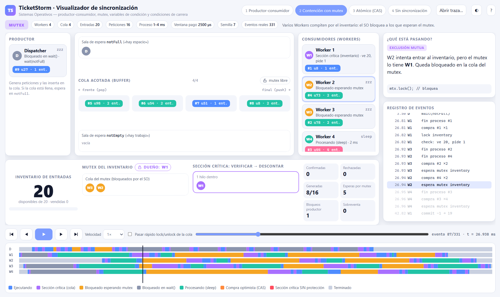

# TicketStorm

Simulación concurrente de un sistema de venta de entradas en **C++17** que implementa el
problema **productor-consumidor** con una cola acotada, `std::mutex` y `std::condition_variable`,
más un **visualizador animado** que reproduce paso a paso lo que hizo el programa real.



- **Dispatcher** (productor): genera peticiones aleatorias (usuario y 1 a 4 entradas).
- **Workers** (consumidores): procesan las peticiones y descuentan entradas del inventario.
- **RequestQueue**: buffer acotado con condiciones «hay espacio» / «hay trabajo» y bandera de cierre.
- **TicketInventory**: contador con tres estrategias — `mutex`, `atomic` (`compare_exchange`, sin cerrojo) y `none` (sin protección, para demostrar la condición de carrera).
- **Logger**: consola protegida con mutex, marcas de tiempo opcionales y salida inyectable.
- **Tracer**: registra en JSON los eventos de sincronización (mutex, `wait`/`notify`, sección crítica, reintentos CAS).

## Visualizador (para la exposición)

Abre [`gui/index.html`](gui/index.html) en el navegador (funciona sin internet). Incluye cuatro escenarios:

| Tecla | Escenario | Concepto de SO |
|---|---|---|
| `1` | Productor-consumidor | Bloqueo en `notFull` / `notEmpty`, espera pasiva |
| `2` | Contención con mutex | Exclusión mutua, cola de hilos bloqueados |
| `3` | Atómico (CAS) | Sincronización sin cerrojo, reintentos |
| `4` | Sin sincronización | Condición de carrera y sobreventa |

Atajos: `Espacio` reproducir/pausa · `←` `→` paso a paso · `+` `−` velocidad · `F` pantalla completa · `T` tema · `?` ayuda.
Enlace directo a un evento: `gui/index.html#nosync@83`. Para una traza propia:

```bash
./ticketstorm --trace demo.json -w 4 -t 20 -r 16   # luego arrastra demo.json al visualizador
make gui                                           # regenera los 4 escenarios (gui/traces.js)
```

## Compilar y probar

Requisitos: compilador con C++17 e hilos (g++/clang++), GNU Make y Bash.
Probado en Windows 11 con MSYS2 (g++ 16.1, UCRT64); también compila en Linux y macOS.

```bash
make                      # compila ./ticketstorm
make test                 # pruebas unitarias (U1–U10) + integración (T1–T10)
make bench                # benchmark del inventario: mutex vs atómico
./ticketstorm --seed 42   # ejecución reproducible
./ticketstorm --help      # todas las opciones
make tsan                 # ThreadSanitizer (Linux/macOS)
```

| Opción | Descripción |
|---|---|
| `--sync-mode mutex\|atomic\|none` | Estrategia del contador (atajos `--atomic`, `--no-sync`) |
| `--timestamps` | Tiempo transcurrido (ms) en cada traza |
| `--trace ARCHIVO` | Guarda los eventos de sincronización para el visualizador |

| Código de salida | Significado |
|---|---|
| 0 | Verificación correcta |
| 1 | Condición de carrera detectada (sobreventa o stock inconsistente) |
| 2 | Peticiones perdidas |
| 64 | Argumentos inválidos |

## Estructura

```
include/   cabeceras (config, dispatcher, logger, request, request_queue, simulation,
           sync_mode, ticket_inventory, tracer, worker)
src/       implementación y main.cpp
tests/     pruebas unitarias de inventario y logger
bench/     micro-benchmark mutex vs atómico
scripts/   run_tests.sh (plan de pruebas) y gen_gui_traces.sh
gui/       visualizador animado + trazas de demostración
docs/      informe técnico (DOCX y PDF)
```

## Equipo

| Integrante | Módulos |
|---|---|
| Mejía Rondan, Giovanni Patrick | `request_queue`, `request` |
| Guillen Valcarcel, Daniel Josue | `dispatcher` |
| Cari Quispe, Juan Manuel | `worker` |
| Subia Huaicane, Edson Fabricio | `ticket_inventory`, `logger`, `tracer`, visualizador |
| Mengoa Valeriano, Brigitte Noelia | `config`, `simulation`, `main`, `Makefile`, `run_tests.sh` |

Universidad Nacional de San Agustín de Arequipa — Sistemas Operativos.
El informe completo está en [`docs/Informe_TicketStorm.pdf`](docs/Informe_TicketStorm.pdf).
